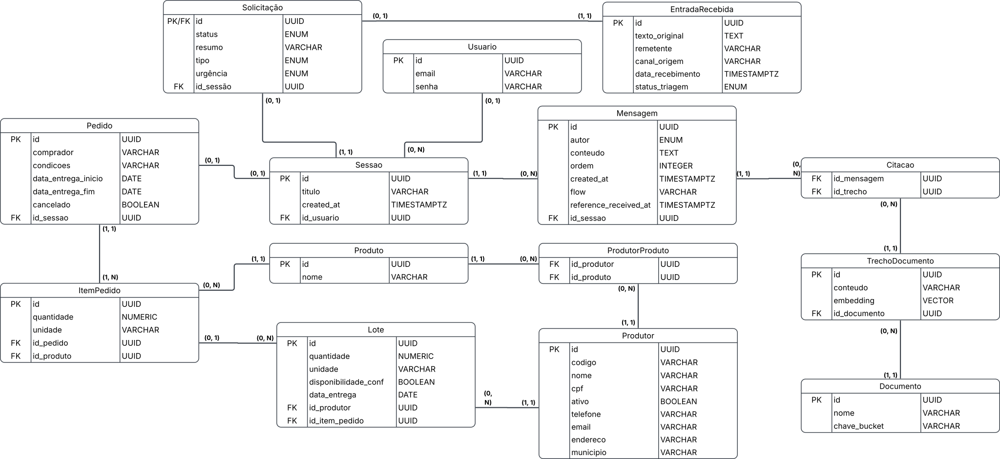

# Banco de dados

O PostgreSQL no Cloud SQL da Google Cloud armazena os usuários, as conversas, os pedidos, os itens, os produtos, os produtores, os Lotes e os dados da consulta documental. A extensão pgvector permite a busca vetorial dos trechos usados no RAG.

Os arquivos originais ficam no Cloud Storage e são representados por `Documento`, que guarda a chave para acessá-los no bucket. Os arquivos de dados fornecidos servem à carga inicial das entidades do sistema. Cada linha aproveitada de `lotes.csv` cria uma instância de `Lote` com os dados úteis às operações e consultas. O vínculo com o arquivo pertence a `Documento`.

## Modelo lógico

Cada sessão é privada ou de triagem. A opção **Nova conversa** cria uma sessão privada, vinculada apenas ao funcionário que a criou. Uma sessão de triagem fica vinculada a exatamente uma solicitação e tem `id_usuario` igual a `NULL`. Cada solicitação tem sua própria sessão de triagem.

A aplicação registra cada mensagem recebida antes da triagem, inclusive as do script de apresentação. A entrada começa com a triagem pendente e preserva o texto, o remetente, o canal e a data de recebimento originais. Quando a origem fornece um identificador estável, a aplicação usa esse identificador e seu contexto de origem para obter sempre o mesmo UUID em reentregas. O formulário usa o UUID do primeiro envio em novas tentativas de entrega. Uma mensagem sem identificador estável recebe um UUID novo.

Cada mensagem nova, inclusive uma resposta, passa por triagem própria. A análise usa a mensagem e a data de recebimento da entrada salva. Se a análise falhar, a mesma entrada fica disponível para nova tentativa, conforme o RF47.

Após a análise, a aplicação cria a sessão sem titular, grava a mensagem original e a análise no histórico inicial, cria a solicitação no estado `recebida` e marca a entrada como `concluída` na mesma transação. O cartão fica disponível após essa gravação. Se a transação falhar, a entrada permanece disponível para recuperação e nenhum cartão parcial é exibido. A reentrega de uma entrada concluída mantém um único cartão, e o resultado atrasado de uma tentativa anterior não substitui o da tentativa vigente.

A solicitação usa o mesmo UUID da entrada que a originou. Cada solicitação tem exatamente uma entrada de origem, e cada entrada pode gerar no máximo uma solicitação. Enquanto a triagem está pendente, em processamento ou falhou, a entrada fica sem solicitação.

Uma sessão pode ter várias mensagens e até um pedido. O pedido fica disponível no chat da sessão em que foi confirmado. Pedidos cadastrados diretamente podem ficar sem sessão.

As mensagens preservam o fluxo executado e a referência temporal utilizada pelo agente, quando conhecidos, permitindo reconstruir o contexto conversacional a partir do histórico persistido. Nas sessões de triagem, os dados originais de recebimento são recuperados de `EntradaRecebida` pelo vínculo com `Solicitacao`, sem duplicá-los nas mensagens do chat.

Um pedido confirmado contém um ou mais itens. Cada `ItemPedido` pertence a um pedido e identifica um produto do catálogo. Um produto pode aparecer em zero ou vários itens.

Um item de pedido pode ter vários lotes. Cada `Lote` identifica o produtor e a quantidade do fornecimento. Para registrar uma alocação operacional, o funcionário deve selecionar um item de pedido existente, que identifica o produto. Um lote histórico importado de `lotes.csv` fica sem vínculo com um item de pedido. O produto e a referência do pedido histórico vêm da linha original do CSV.

`ProdutorProduto` relaciona os produtores aos produtos que fornecem. Cada associação identifica exatamente um produtor e um produto. Um produtor pode fornecer vários produtos, e um produto pode ser fornecido por vários produtores. Ambos podem existir antes de receber associações. Esse relacionamento permite sugerir fornecedores mesmo quando ainda não possuem Lotes cadastrados.

Cada trecho pertence a um documento. Uma resposta pode citar vários trechos, e um trecho pode aparecer em várias respostas. A aplicação usa o documento de cada trecho para abrir o original no bucket. A exclusão é bloqueada quando alguma resposta cita o documento.

Ao citar um registro de CSV, a aplicação usa os metadados da fonte recuperada para associar à resposta o documento original e o identificador do registro, como `lote_id` ou `id_transacao`. O identificador localiza o registro dentro do arquivo mesmo se a ordem das linhas mudar. A citação apresenta os campos pertinentes do registro e permite acessar o arquivo original usado na resposta.

## Dicionário de dados

| Entidade | Campos | Restrições |
| --- | --- | --- |
| `Usuario` | `id` (UUID), `email` (VARCHAR), `senha` (VARCHAR) | `id` é a chave primária. O e-mail é único e `senha` guarda o hash. |
| `Sessao` | `id` (UUID), `titulo` (VARCHAR), `created_at` (TIMESTAMPTZ), `id_usuario` (UUID) | `id` é a chave primária. `created_at` é obrigatório e registra a criação da sessão. `id_usuario` é uma FK opcional para `Usuario` e corresponde a `chat_sessions.user_id` na implementação. Cada sessão deve ter um titular ou estar vinculada a uma solicitação, exclusivamente. Um usuário pode ser titular de várias sessões privadas. |
| `Solicitacao` | `id` (`UUID`), `status` (`ENUM`), `resumo` (`VARCHAR`), `tipo` (`ENUM`), `urgencia` (`ENUM`), `id_sessao` (`UUID`) | `id` é a chave primária e também uma FK para `EntradaRecebida.id`. `id_sessao` é uma FK obrigatória e única para `Sessao`. `status` começa em `recebida` e segue o RF15. `tipo` e `urgencia` seguem o RF04. |
| `EntradaRecebida` | `id` (UUID), `texto_original` (TEXT), `remetente` (VARCHAR), `canal_origem` (VARCHAR), `data_recebimento` (TIMESTAMPTZ), `status_triagem` (ENUM) | Todos os campos são obrigatórios. `id` é a chave primária usada para reconhecer reentregas. `canal_origem` preserva o canal original, inclusive para mensagens do script de apresentação. `status_triagem` começa em `pendente` e também pode ser `em processamento`, `concluída` ou `falhou`. |
| `Mensagem` | `id` (UUID), `id_sessao` (UUID), `autor` (ENUM), `conteudo` (TEXT), `ordem` (INTEGER), `created_at` (TIMESTAMPTZ), `fluxo` (VARCHAR), `data_referencia` (TIMESTAMPTZ) | `id` é a chave primária. `autor` corresponde a `chat_messages.role` no backend. É obrigatório e aceita apenas `USER` e `AGENT`. `USER` identifica mensagens de autoria humana, incluindo a mensagem original do remetente externo e os esclarecimentos dos funcionários. `AGENT` identifica mensagens produzidas pelo agente, incluindo a análise inicial da triagem. `conteudo` é obrigatório. `created_at` é obrigatório e registra a criação da mensagem no chat. `fluxo` corresponde a `chat_messages.flow` e aceita `triage` ou `consultation`, podendo ficar `NULL` quando o fluxo não for conhecido. `data_referencia` corresponde a `chat_messages.reference_received_at` e registra a referência temporal utilizada pelo agente, podendo ficar `NULL` quando essa informação estiver ausente. Para a triagem, a data original de recebimento fica em `EntradaRecebida.data_recebimento`. `id_sessao` é uma FK obrigatória para `Sessao`. `ordem` é obrigatória, e o par (`id_sessao`, `ordem`) é único. |
| `Pedido` | `id` (UUID), `id_sessao` (UUID), `comprador` (VARCHAR), `condicoes` (VARCHAR), `data_entrega_inicio` (DATE), `data_entrega_fim` (DATE), `cancelado` (BOOLEAN) | `id` é a chave primária. `id_sessao` é uma FK opcional e única para `Sessao`. Comprador, data inicial e cancelamento são obrigatórios. Condições e data final podem ficar vazias. Quando preenchida, a data final deve ser igual ou posterior à inicial. |
| `ItemPedido` | `id` (UUID), `quantidade` (NUMERIC), `unidade` (VARCHAR), `id_pedido` (UUID), `id_produto` (UUID) | `id` é a chave primária. `id_pedido` e `id_produto` são FKs obrigatórias para `Pedido` e `Produto`. O cadastro confirmado exige quantidade positiva e unidade definida. |
| `Produto` | `id` (UUID), `nome` (VARCHAR) | `id` é a chave primária. O nome padronizado é obrigatório e único. O catálogo é preenchido pela carga inicial e disponibilizado para consulta e seleção. |
| `Produtor` | `id` (UUID), `codigo` (VARCHAR), `nome` (VARCHAR), `cpf` (VARCHAR), `ativo` (BOOLEAN), `telefone` (VARCHAR), `email` (VARCHAR), `endereco` (VARCHAR), `municipio` (VARCHAR) | `id` é a chave primária. Código, nome, CPF e situação ativo/inativo são obrigatórios. Código e CPF são únicos. Telefone, e-mail, endereço e município podem ficar vazios. |
| `ProdutorProduto` | `id_produtor` (UUID), `id_produto` (UUID) | Os campos são FKs obrigatórias para `Produtor` e `Produto` e formam a chave primária composta. Cada par de produtor e produto aparece uma única vez. |
| `Lote` | `id` (UUID), `quantidade` (NUMERIC), `unidade` (VARCHAR), `disponibilidade_conf` (BOOLEAN), `data_entrega` (DATE), `id_produtor` (UUID), `id_item_pedido` (UUID) | `id` é a chave primária. `id_produtor` é uma FK obrigatória para `Produtor`. `id_item_pedido` é uma FK para `ItemPedido`. Na carga histórica, o campo fica `NULL`. O serviço exige esse vínculo para cadastrar ou editar uma alocação operacional. A quantidade é obrigatória e positiva. A unidade é obrigatória no cadastro operacional e aceita `NULL` quando a fonte deixa a unidade indefinida. `disponibilidade_conf` deve ser verdadeira no cadastro ou na edição operacional e aceita `NULL` quando a fonte não informa a confirmação de disponibilidade. `data_entrega` guarda a data prevista de entrega. |
| `Documento` | `id` (UUID), `nome` (VARCHAR), `chave_bucket` (VARCHAR) | `id` é a chave primária. Nome e chave são obrigatórios. `chave_bucket` é única e identifica o arquivo original no bucket. |
| `TrechoDocumento` | `id` (UUID), `id_documento` (UUID), `conteudo` (VARCHAR), `embedding` (VECTOR) | `id` é a chave primária. `id_documento` é uma FK obrigatória para `Documento`. A dimensão do vetor depende do modelo de embeddings. |
| `Citacao` | `id_mensagem` (UUID), `id_trecho` (UUID) | Os campos são FKs obrigatórias para `Mensagem` e `TrechoDocumento` e formam a chave primária composta. |

## Regras dos pedidos e Lotes

Os produtos solicitados são registrados em `ItemPedido`. O campo `Pedido.condicoes` guarda as condições de atendimento revisadas pelo funcionário. Para entrega em data única, o pedido usa `data_entrega_inicio`. Para um intervalo, usa também `data_entrega_fim`.

O prazo do pedido indica a data ou o intervalo aceito pelo comprador. Na alocação, o funcionário confirma com o produtor o dia previsto para o fornecimento. O serviço grava esse dia em `data_entrega` se ele coincidir com a data única do pedido ou estiver dentro do intervalo, incluindo os extremos. O resumo por produtor usa a data de cada lote para selecionar os fornecimentos do período.

O saldo do item corresponde à quantidade solicitada menos a soma das alocações operacionais vigentes daquele item. O cálculo usa a unidade do item e converte quantidades apenas quando houver equivalência conhecida. Quantidades com unidade indefinida ficam fora dos totais até esclarecimento. Se a quantidade solicitada ou as unidades necessárias ao cálculo estiverem pendentes, o saldo deve ser apresentado como indeterminado.

Para cadastrar ou editar um lote operacional, o serviço exige um item vinculado, pedido e produtor ativos e os dados necessários para validar o saldo. O funcionário confirma a disponibilidade para o produtor, a quantidade, a unidade e a data de entrega. Se algum desses dados mudar, o funcionário confirma a disponibilidade para o fornecimento revisado. No chat, o funcionário confirma a versão revisada do rascunho, e a conversa guarda as mensagens originais e os esclarecimentos. O serviço valida os dados atuais no cadastro direto e na confirmação pelo chat. A gravação respeita o limite solicitado mesmo quando outra operação altera o saldo ao mesmo tempo.

Ao cancelar um pedido, o sistema remove as alocações operacionais vinculadas a ele e mantém o pedido disponível para consulta. Os lotes importados continuam disponíveis. A regra vale também quando um cadastro de alocação ocorre em paralelo ao cancelamento.

## Carga inicial

O processo de carga associa os produtores e produtos aos registros correspondentes do sistema e cria as associações de `ProdutorProduto`. O catálogo usa nomes padronizados, e a interpretação das mensagens permite ao assistente pedir esclarecimento quando faltar informação para selecionar um produto.

A indexação de `financeiro.csv` cria um registro por linha no índice do RAG. Cada registro mantém o vínculo com o CSV original e preserva o `id_transacao`. A carga mantém consultáveis, junto ao registro indexado, o identificador do produtor, o tipo da transação, o valor total e as datas da transação, do vencimento e do pagamento. A ferramenta do resumo consulta esses campos para selecionar todos os registros que atendam ao RF08 e retorna os valores calculados com os identificadores das transações usadas.

A aplicação importa cada linha de `lotes.csv` como um fornecimento confirmado na base, com entrega prevista. A carga grava em `Lote` o produtor, a quantidade e a data da linha em `data_entrega`, e deixa `id_item_pedido` como `NULL`. O produto e a referência do pedido histórico são consultados na linha de origem. A quantidade originalmente solicitada e o prazo combinado com o comprador ficam desconhecidos quando a fonte informa apenas os dados do lote.

A carga usa a unidade indicada no registro ou nas observações, como nas 300 unidades de alface e nos 150 maços de coentro. No caso de "40 maços (kg)", a descrição fica disponível no CSV, a unidade fica vazia e a aplicação apresenta a pendência ao funcionário. A quantidade fica fora dos totais e das conversões até o esclarecimento. Se a fonte não informar a confirmação de disponibilidade, `disponibilidade_conf` fica vazio.

A carga inicial é executada por comando explícito durante a preparação do ambiente. Os dados complementares dos Lotes históricos permanecem no arquivo de origem e são disponibilizados para consulta por meio da indexação documental.